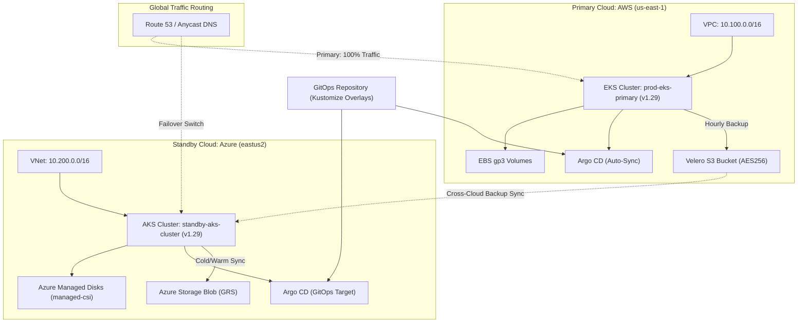

# Multi-Cloud Kubernetes Disaster Recovery Architecture

## System Design & Component Overview

This architecture provides active-passive cross-cloud disaster recovery for stateful containerized workloads between **Amazon Web Services (EKS)** and **Microsoft Azure (AKS)**.

## Storage Abstraction & Translation

One of the largest hurdles in cross-cloud disaster recovery is volume driver incompatibility. 

1. **StorageClass Dynamic Remapping**:
   Velero's `change-storage-class` plugin maps AWS StorageClass `gp3` directly to Azure `managed-csi` on restoration.
2. **File-System Backup (Kopia / Node-Agent)**:
   Rather than proprietary hypervisor block snapshots, Velero `node-agent` takes deduplicated, encrypted file-system level snapshots of persistent volumes directly from the pod mount points. This guarantees complete portability between AWS EBS and Azure Managed Disks.

## Network Topology & Security

- **EKS**: Private subnets across 3 Availability Zones (`us-east-1a`, `us-east-1b`, `us-east-1c`) with NAT Gateway egress and public Load Balancer subnets.
- **AKS**: Azure CNI with Calico Network Policies, isolated subnets for worker nodes and external ingress.
- **Identity & Security**:
  - AWS: IAM Roles for Service Accounts (IRSA) eliminating long-lived API keys.
  - Azure: Azure Workload Identity using OIDC federation with Azure Managed Identity.
